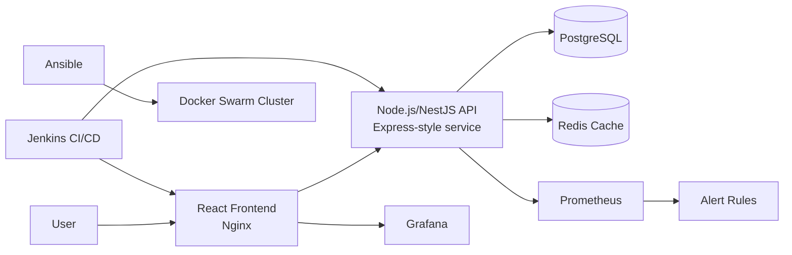

# Smart Recruit DevOps Portfolio Project

This project is a complete DevOps portfolio implementation that demonstrates containerization, CI/CD, infrastructure automation, secrets management, monitoring, backups, and scalability testing for a production-style application stack.

## Architecture



## Why these tools

- Node.js + NestJS: fast API development with structured backend services and built-in validation.
- React: simple and readable frontend display for the portfolio.
- PostgreSQL: relational database for durable application state.
- Redis: cache acceleration and lightweight session-like state.
- Docker + Compose: local dev workflow and repeatable application packaging.
- Docker Swarm: multi-node orchestration with replicas and health-based recovery.
- Jenkins: pipeline automation for build, test, scan, deploy, and rollback.
- Ansible: repeatable infrastructure provisioning and NGINX/TLS configuration.
- HashiCorp Vault / Docker secrets: secret injection without storing sensitive values in Git.
- Prometheus + Grafana: operational observability and alerting.
- k6: realistic load generation to validate scalability.

## Repo structure

- smart-recruit-frontend/ — React frontend and its Docker image
- smart-recruit-backend/ — NestJS API and its Docker image
- docker-compose.yml — local application, database, cache, and monitoring stack
- docker/ — Docker Swarm deployment documentation and stack
- infra/ — Ansible inventory and playbooks
- ci/ — combined Jenkins pipeline and quality gates
- monitoring/ — Prometheus rules/configuration and provisioned Grafana dashboard
- scripts/ — backup, restore, and load-test utilities
- README.md — project documentation

## Prerequisites

- Docker + Docker Compose
- Node.js 22+
- Python 3 for Ansible
- Jenkins agent or Jenkins server
- Access to a container registry
- A target staging/production environment

## Local development

From the repository root, copy the example environment file and start the complete
stack. The root Compose file builds both application services and starts their
PostgreSQL/Redis dependencies together with Prometheus and Grafana:

```powershell
Copy-Item .env.example .env
docker compose up --build -d
docker compose ps
```

Open:

- Frontend: http://localhost:5173
- Backend health: http://localhost:5000/health
- Backend metrics: http://localhost:5000/metrics
- Prometheus: http://localhost:9090
- Grafana: http://localhost:3000 (default local login: `admin` / `admin`)

Grafana automatically provisions the Prometheus datasource and Smart Recruit
dashboard. Prometheus scrapes the backend and node exporter and loads the alert
rules from `monitoring/`.

To follow startup logs or stop the stack:

   ```bash
   docker compose logs -f
   docker compose down
   ```

Persistent data is kept in named Docker volumes. To also remove the database,
uploads, and monitoring history, run `docker compose down --volumes`.

The root `ci/Jenkinsfile` is the combined frontend/backend pipeline. Running its
full deployment stages requires a configured Linux Jenkins agent, registry and
SonarQube credentials, Trivy, and the staging/production Ansible inventories.

## Deployment flow

1. Build and test in Jenkins.
2. Run SonarQube and Trivy scans.
3. Push to registry.
4. Deploy to staging using Ansible + Docker Swarm.
5. Run smoke tests.
6. Require manual approval.
7. Deploy to production.
8. Trigger rollback automatically if the production health check fails.

## Secrets management

This project avoids storing secrets in Git. Use either Docker secrets or Vault injection. Example patterns:

```bash
# Docker secrets
printf '%s' 'supersecret' | docker secret create smart-recruit-db-password -
printf '%s' 'jwt-secret-value' | docker secret create smart-recruit-jwt-secret -
```

The backend reads secret values through `*_FILE` environment variables such as `DB_PASSWORD_FILE` and `JWT_SECRET_FILE`.

## Monitoring

Prometheus scrapes app metrics from `/metrics`. Grafana dashboards are provisioned under `monitoring/grafana/provisioning`.

## Backup and restore

Run backup:

```bash
chmod +x scripts/backup-db.sh
DB_HOST=postgres DB_NAME=smart_recruit DB_USER=smart_recruit POSTGRES_PASSWORD=... ./scripts/backup-db.sh
```

Restore:

```bash
chmod +x scripts/restore-db.sh
./scripts/restore-db.sh /path/to/backup.dump
```

## Scalability

Run a load test with k6:

```bash
k6 run scripts/k6-load-test.js --env API_BASE_URL=http://localhost:5000
```

Example scaling commands for Docker Swarm:

```bash
docker service scale smart-recruit_backend=4
docker service scale smart-recruit_frontend=3
```

## Challenges and lessons learned

- Separate data services from application services to reduce blast radius.
- Keep health endpoints dependency-aware so the stack can fail fast and recover predictably.
- Use secret files for runtime injection instead of environment variables in source control.
- Treat CI/CD and infrastructure automation as first-class deliverables in a portfolio project.
- Validate monitoring and rollback behavior early because those are critical in production operations.

## Screenshots

- Architecture diagram placeholder
- CI pipeline placeholder
- Monitoring dashboard placeholder
- Deployment flow placeholder

## Notes

This repository is designed for a portfolio project and should be tweaked with your actual registry URLs, domain names, and environment metadata before production use.
